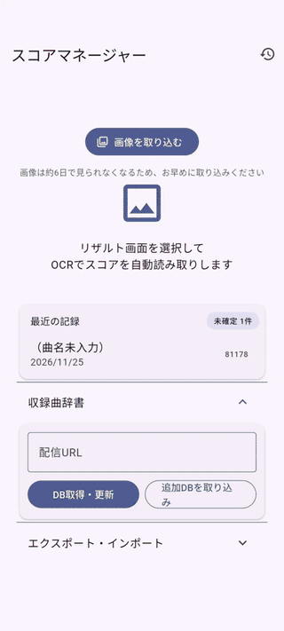

# スコアヨミPM

特定の音楽ゲームのプレイ結果を、スマートフォンで撮った写真等から読み取って記録する Android アプリ。

## インストール（Android）

[Releases](https://github.com/noexcelnolife/ScoreYomiPM/releases/latest) から最新の APK をダウンロードし、端末で開いてインストールする。Google Play では配布していない。

- 対応 OS: Android 7.0（API 24）以上
- 「提供元不明のアプリ」からのインストールを許可する必要がある
- 要求する権限は**カメラと通信用のみ**（ストレージ・マイク・位置情報は要求しない）
- 記録は端末内に保存される。撮影した画像を外部へ送信する処理は無い

> 各版の変更内容は [Releases](https://github.com/noexcelnolife/ScoreYomiPM/releases) のページに記載している。

## アプリの概要

リザルト画面の写真を集めるだけで、曲名・難易度・スコア・判定内訳などのプレイ記録を端末内に記録していける。

アプリ名の「**スコアヨミ**」は、リザルト画像からスコアを読み取ることを表している。「**PM**」は **Play Memory**（プレイの記録）の略で、プレイの記録を端末内に貯めていくことを意味する。

このアプリを開発する動機は次の通り。

- **手入力は手間がかかる** 1 回のプレイで記録したい値は、曲名・難易度・レベル・スコア・判定内訳（COOL / GREAT / GOOD / BAD）・MAX COMBO・クリアメダル・機種と 11 項目ある。毎回これを転記するのは現実的ではないため、リザルト画像から自動で読み取る方式にしている。
- **電波が悪いことがある** 読み取り（OCR）はすべて端末内で完結し、撮影した画像を外部へ送信する処理はない。電波のない場所でも記録できる。

### 操作例



> 動画版は [demo.mp4](docs/media/demo.mp4) を参照。

## 主な使い方

HCのリザルトをカメラで読み取り、保存し、ホーム画面に戻って記録一覧で確認するまでの流れを次に例示する。

### 操作説明

撮影から保存、記録一覧での確認までの一連の流れを動画にしたもの。

<video src="https://github.com/user-attachments/assets/090c62ec-df1f-4b90-9f27-d0539de8a004" controls></video>


> GitHub では上のプレイヤーで、GitLab では下のプレイヤーで再生できる。どちらでも再生されない場合は [guide.mp4](docs/media/guide.mp4) を参照。

### 1. アプリホーム画面からリザルトを撮影する

1. アプリを開くとホーム画面が表示される。
2. 画面の「**画像を取り込む**」を押す。
3. 取り込み方法のシートが開く。機種は既定で **H☆C!!** が選ばれている（`未指定` も選択できる）。
4. 「**HC リザルト写真**」→「**カメラで撮影**」を選ぶとカメラが起動する。
5. 画面に出るガイド枠に、リザルト画面全体が収まるように合わせて撮影する。

> 端末に保存済みの写真から取り込む場合は、同じシートで「**ギャラリーから選択**」。プレーシェア画像を使う場合は「**HC プレーシェア**」を選ぶ。他のアプリから画像を共有でも取り込める。

### 2. 読み取り結果を確認して保存する

1. 撮影すると自動で OCR が走り、「**OCR結果確認**」画面が開く。
2. 画面の一番上に読み込んだ画像が表示される（拡大・移動できる）。読み取った内容と画像を見比べながら確認する。
3. 読み取った内容を確認する。曲名は候補が表示されるので、**タップすると入力欄に入る**。難易度・クリアメダル・機種は選択肢から選び、スコア・判定内訳・MAX COMBO は数値を直接直せる。
4. 読み取りが怪しい項目には「要確認」の表示が出る。判定内訳の合計とスコアが食い違う場合などは、保存前に警告が出る。
5. 内容に問題がなければ「**スコアを保存**」を押す。保存するとホーム画面に戻る。

> 写真を撮らずに記録したいときは、シートの「**写真なしで手入力**」から同じ項目を入力できる（こちらは続けて入力できるよう画面に留まる）。OCR が失敗した場合も、画像だけを「未確定」の記録として残しておき、あとから入力し直せる。

### 3. ホームに戻って記録を一覧で確認する

1. ホーム画面の右上にある履歴アイコン（**記録一覧**）を押す。
2. 保存した記録が一覧で表示される。上部には総記録数・演奏曲数・フルコンボ数が表示される。
3. 曲名で検索、並び順は「実施日の新しい順」「スコアの高い順」から選べる。
4. 一覧の行をタップすると記録の詳細が開く。ここから「**修正**」「**削除**」ができ、「未確定」の記録は「**再OCR**」も実行できる。

## 機能一覧

### 取り込み

| 機能 | 内容 |
| --- | --- |
| HC リザルト写真 | カメラで撮影、またはギャラリーから選択 |
| HC プレーシェア画像 | プレーシェア画像をギャラリーから選択 |
| 写真なしで手入力 | 画像なしで 11 項目を直接入力 |
| 共有からの取り込み | 他アプリから画像を共有するとこのアプリで受け取れる |
| 撮影ガイド枠 | リザルト画面全体を収めるための枠をカメラ画面に重ねて表示 |
| 失効ガイド | プレーシェア画像が約 6 日で見られなくなることをホーム画面に常時表示 |

### 読み取り（OCR）

| 機能 | 内容 |
| --- | --- |
| 端末内 OCR | Google ML Kit の日本語テキスト認識を端末内で実行（画像は送信しない） |
| 入力の種別 | スコア画面の写真を「H&C のプレイシェア画像」と「PC 版 Lively のリザルト画面」から選ぶ。種別ごとに読み取りの経路が変わる（Lively を選ぶと機種も Lively になる） |
| 撮影ガイド | その場で撮る場合は、枠線付きの撮影画面でスコア画面を収めて撮影できる（ギャラリーからの選択も可） |
| 抽出項目 | 曲名・難易度・レベル・スコア・判定内訳（COOL / GREAT / GOOD / BAD）・MAX COMBO・クリアメダル・機種 |
| 曲名候補 | 収録曲辞書から候補を提示し、タップで入力 |
| 信頼度表示 | 項目ごとの読み取り信頼度を表示し、怪しい項目を「要確認」として強調 |

### 曲名入力の支援

| 機能 | 内容 |
| --- | --- |
| サジェスト | 曲名欄に入力すると収録曲辞書から候補を出す |
| 全件検索 | 曲名欄から全件検索画面へ移り、複数候補から選べる（完全一致→前方一致→部分一致の順、最大 200 件） |
| 難易度とレベル | 候補行に 4 難易度すべてのレベルを表示する |
| 自動入力 | 曲名を確定すると難易度とレベルの選択ダイアログを出し、選ぶと入力欄へ反映する（「自動入力しない」も選べる） |

### 保存前のチェック

保存前に次の整合性を検査し、矛盾があれば警告する。

| 検査 | 内容 |
| --- | --- |
| スコアと判定内訳 | 判定内訳から逆算したスコアが実際のスコアと矛盾しないか |
| クリアメダルと BAD | メダルの種類と BAD の数が矛盾しないか |
| MAX COMBO と判定合計 | MAX COMBO が判定の合計を超えていないか |
| 総ノーツ数 | 収録曲辞書のノーツ数と判定内訳の合計が一致するか |

### 記録の閲覧・編集

| 機能 | 内容 |
| --- | --- |
| 記録一覧 | 全記録の一覧、総記録数・演奏曲数・フルコンボ数の統計 |
| 検索 | 曲名での絞り込みとサジェスト |
| 並び替え | 実施日の新しい順 / スコアの高い順 |
| 自己ベスト | 曲名と難易度の組み合わせごとに自己ベストを判定して表示 |
| 記録詳細 | 全項目の表示、リザルト画像の表示（拡大・移動可）、テキストの選択コピー、原画像のアプリ外への書き出し |
| 修正・削除 | 記録の編集と削除 |
| 未確定レコード | OCR に失敗しても画像付きで残し、あとから再 OCR や手入力ができる |

### データ管理

| 機能 | 内容 |
| --- | --- |
| 収録曲辞書 | 曲名候補と総ノーツ数の照合に使う辞書。配信 URL を設定すると辞書を取得・更新できる。追加の辞書ファイルの取り込みにも対応。読み込み状態と版、直近の更新結果を画面に表示する |
| バックアップ | ZIP（画像込み）または CSV（画像なし）で書き出し |
| 復元 | ZIP から復元（追加 / 置換を選択、取り込み前のプレビュー、重複のスキップ） |

### その他

| 機能 | 内容 |
| --- | --- |
| オフライン動作 | 記録と OCR は端末内で完結。通信するのは収録曲辞書を更新するときだけ |
| アダプティブアイコン | Android のアダプティブアイコン（テーマアイコン用のモノクロ版を含む）に対応 |

## ビルド

### 事前準備

| 項目 | 内容 |
| --- | --- |
| Flutter | 3.50.1（stable / Dart 3.14）。`pubspec.yaml` の制約は `sdk: ^3.14.0` |
| JDK | 17 以上（`android/app/build.gradle.kts` の `sourceCompatibility` / `jvmTarget` が 17） |
| Android SDK | compileSdk 37 と、それに対応する build-tools・platform-tools |
| ネットワーク | 初回ビルド時のみ。Gradle 9.5.0・AGP 9.3.1・Kotlin 2.4.20 と各依存パッケージを取得する |


### 手順

```bash
flutter pub get
flutter run
```

`flutter run` は接続中の実機、または起動済みのエミュレータでアプリを起動する。配布用の APK を作る場合は次のとおり。

```bash
flutter build apk --release
```

出力は `build/app/outputs/flutter-apk/app-release.apk`。AAB が必要な場合は `flutter build appbundle`（出力は `build/app/outputs/bundle/release/app-release.aab`）。バージョンは `pubspec.yaml` の `version`（現在 `1.0.1+2`）がそのまま `versionName` / `versionCode` になる。

### リリースビルドに関する注意

- 署名は**自前の keystore が必須**である。`android/key.properties` が無いと `flutter build apk --release` は意図的に失敗する。手順は [`RELEASING.md`](RELEASING.md) を参照。Flutter テンプレート既定の「debug 鍵にフォールバックする」設定は、誰でも同じ鍵で APK を作れてしまう（＝なりすましが可能）ため削除している。
  - **`key.properties` が無くても `flutter build apk --debug` と `flutter run` は動く。** 鍵を作る前から開発できるようにするため、失敗するのは release だけに限定している。
- `isMinifyEnabled` / `isShrinkResources` は**意図的に無効**にしている。有効にすると ML Kit 内部で例外が出て OCR が必ず失敗することを実機で確認済みであり、この設定を変えると読み取りが動かなくなる。

### 要件テスト

```bash
flutter analyze
flutter test
```

`flutter analyze` は警告 0 を維持している。`flutter test` は 805 件で、手元では 784 件が実行され 21 件がスキップされる。スキップされるのは、実画像（`testimage/`）や生成物（`db/`）が無い環境で前提を満たさないテストである。そのうち実画像 6 枚を使って傾き推定の精度をみる 1 件は所要時間が約 171 秒あるため、`testimage/` があっても既定では実行しない。

スキップしている重いテストは、傾き推定を変更したときだけ次のように明示的に実行すべきであろう。

```bash
flutter test --dart-define=RUN_SLOW_TESTS=true test/roll_corrector_test.dart
```

## 設計文書について

ソース中のコメントには `spec.md`（仕様書）や `tool/*.txt`（実測ログ）への参照が残っているが、これらは作者限りの内部資料で、このリポジトリには含めていない（現在は作者の手元にも残していない）。コメントには結論（数値・閾値・理由）をそのまま書いてあるので、参照先が無くても読み解ける。

## 要求する権限

| 権限 | 用途 | 許可しない場合 |
|---|---|---|
| `CAMERA`（任意） | アプリ内の撮影画面でスコアを撮るとき | ギャラリーやファイルからの取り込みは使える |
| `INTERNET` | 収録曲辞書を配信 URL から更新するときのみ | 同梱の辞書で動作する（更新だけができない） |
| `ACCESS_NETWORK_STATE` | 上記の更新時に通信可能な状態かを確認する | 影響なし（実行時に許可を求める種類の権限ではない） |

## 同梱フォントとライセンス

画面表示には **BIZ UDPGothic** を同梱して使っている（`assets/fonts/`）。

- BIZ UDPGothic — Copyright 2022 The BIZ UDGothic Project Authors
- ライセンス: SIL Open Font License 1.1（全文は `assets/fonts/OFL.txt`。APK 内にも同梱）

## 無保証であることの注記

- 本ソフトウェアは**現状有姿（as-is）で提供される。明示・黙示を問わず、いかなる保証も行わない。** 動作の正確性、特定目的への適合性、記録データが失われないことを含め、一切保証しない。
- 本アプリの利用、および利用できなかったことによって生じたいかなる損害についても、開発者は責任を負わない。**大切な記録はバックアップ機能で定期的に書き出すべきである。**
- OCR の結果は必ずしも正しいとは限らない。保存前の確認と、保存後の修正が必要である。
- 本アプリは**非公式のツール**である。ゲーム・楽曲の権利者とは一切関係がなく、彼らからの承認・提携を受けたものでもない。

